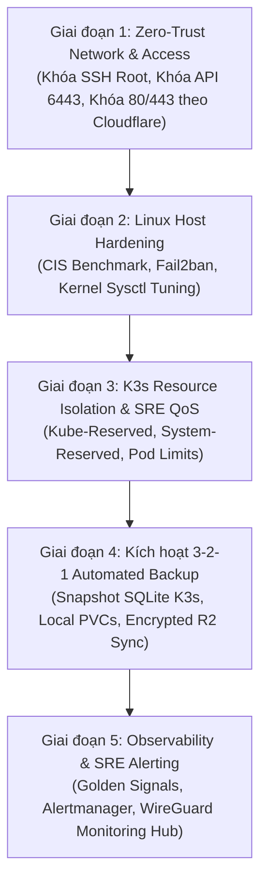

# Kế hoạch Chuẩn hóa VPS Nội bộ & Cụm K3s theo Tiêu chuẩn Enterprise / Big-Tech SRE

**Tác giả:** Senior DevOps Engineer / SRE Specialist  
**Mục tiêu:** Nâng cấp VPS `vmi3371043` (`13.140.183.90`) đạt chuẩn bảo mật CIS Benchmark, khả năng tự phục hồi (High Resilience), giám sát toàn diện (Observability), và tự động hóa vận hành không phụ thuộc thao tác thủ công.  
**Tài liệu tham chiếu:** [security-hardening-and-ddos-runbook.md](file:///home/platform-gitops/docs/security-hardening-and-ddos-runbook.md) · [runbook-dr.md](file:///home/platform-gitops/docs/runbook-dr.md) · [k3s-cluster-architecture.md](file:///home/platform-gitops/docs/k3s-cluster-architecture.md)

---

## 1. Triết lý Thiết kế Kiến trúc (Design Philosophy)

Tại các công ty công nghệ lớn, một VPS (kể cả VPS nội bộ đơn lẻ) phải tuân thủ nghiêm ngặt 5 nguyên tắc:

1. **Zero Trust Perimeter (Không tin cậy tầng biên):** Mọi cổng quản trị (SSH, Kube API) **không bao giờ được mở công khai ra Internet (0.0.0.0/0)**. Bắt buộc phải qua VPN (WireGuard/Tailscale) hoặc Zero-Trust Tunnel.
2. **Defense in Depth (Phòng thủ đa tầng):** Nếu kẻ tấn công vượt qua Cloudflare WAF, chúng vẫn bị chặn bởi UFW Host, Traefik Rate-Limit, Kubernetes NetworkPolicy, và Pod Security Standards.
3. **Immutable & Declarative Everything (Bất biến & Định nghĩa bằng code):** Toàn bộ trạng thái máy chủ và cụm k8s phải nằm trong Git (GitOps qua ArgoCD + IaC qua Ansible). Không thao tác cấu hình thủ công không lưu vết (No Ad-hoc Changes).
4. **SRE Reliability & Predictable Performance:** Tài nguyên hạn chế (2 vCPU / 4GB RAM) phải được phân bổ có trật tự qua QoS classes. Kernel Linux và K3s phải được cấu hình để **không bao giờ bị treo cứng hệ điều hành khi bị spike load**.
5. **Continuous Data Protection (Bảo vệ dữ liệu liên tục):** Tuân thủ quy tắc 3-2-1 backup với RTO < 45 phút và RPO < 6 giờ.

---

## 2. Bảng Phân tích Lỗ hổng Hiện trạng (Gap Analysis)

| Hạng mục | Hiện trạng trên VPS (`vmi3371043`) | Chuẩn Big-Tech / Enterprise | Mức độ rủi ro |
| :--- | :--- | :--- | :---: |
| **Quyền truy cập SSH** | SSH trực tiếp bằng user `root`, cổng `22` mở toàn cầu | User riêng (`devops`), sudo qua SSH key ed25519, `PermitRootLogin no`, khóa cổng 22 chỉ cho phép qua VPN/Admin IP | 🔴 **Nghiêm trọng** |
| **K3s API (Port 6443)** | Lắng nghe `0.0.0.0:6443`, UFW mở `Anywhere` | Chỉ lắng nghe nội bộ / WireGuard VPN hoặc bảo vệ bằng Cloudflare Access / Admin IP whitelist | 🔴 **Nghiêm trọng** |
| **Web Traffic (80/443)** | UFW mở `Anywhere` cho mọi IP Internet | Chỉ chấp nhận dải IP của Cloudflare Proxy (ngăn chặn bypass CDN tấn công trực diện VPS) | 🟡 **Trung bình** |
| **Quản lý RAM K3s** | Báo `108%` allocatable, không có ngưỡng bảo vệ OS | Định cấu hình rõ ràng `system-reserved` (400Mi) và `kube-reserved` (500Mi) để bảo vệ kernel | 🟡 **Trung bình** |
| **Sao lưu (Backup)** | Dữ liệu K3s SQLite & PVC chưa sync sang R2 | Tự động hóa snapshot mỗi 6h, mã hóa `age`, đẩy sang Cloudflare R2 | 🟡 **Trung bình** |
| **Bảo vệ Brute-force** | Chưa có Fail2ban / CrowdSec giám sát SSH & API | Tự động phát hiện và khóa IP quét cổng (Intrusion Detection System) | 🟡 **Trung bình** |
| **Cập nhật Hệ thống** | Chạy cập nhật thủ công bằng tay | `unattended-upgrades` tự động vá lỗ hổng bảo mật kernel/packages | 🟢 **Thấp** |

---

## 3. Lộ trình Thực thi 5 Giai đoạn (5-Phase Implementation Plan)



---

### GIAI ĐOẠN 1: BẢO MẬT TẦNG BIÊN & TRUY CẬP (ZERO-TRUST PERIMETER)

#### Mục tiêu:
* Loại bỏ hoàn toàn việc truy cập trực tiếp bằng `root` qua SSH công khai.
* Ngăn chặn kẻ tấn công bypass Cloudflare để DDoS trực diện vào IP gốc `13.140.183.90`.
* Thu hẹp bề mặt tấn công của Kubernetes API Server.

#### Các bước triển khai:

1. **Chuẩn hóa User quản trị & Vô hiệu hóa Root SSH:**
   * Tạo tài khoản định danh riêng: `devops` (thuộc nhóm `sudo`).
   * Cấu hình SSH Key ed25519, tắt hoàn toàn Password Authentication.
   * Cập nhật `/etc/ssh/sshd_config.d/99-hardening.conf`:
     ```text
     PermitRootLogin no
     PasswordAuthentication no
     PubkeyAuthentication yes
     X11Forwarding no
     MaxAuthTries 3
     ClientAliveInterval 300
     ClientAliveCountMax 2
     ```
2. **Khóa cổng Web (80/443) chỉ cho phép Cloudflare IP:**
   * Kích hoạt script có sẵn [harden-cloudflare-ufw.sh](file:///home/platform-gitops/scripts/harden-cloudflare-ufw.sh).
   * Script này sẽ fetch danh sách IP chính thức từ `https://www.cloudflare.com/ips-v4` và `ips-v6`, cấu hình UFW chỉ cho phép các IP này tới cổng 80, 443; từ chối tất cả các IP lạ truy cập trực tiếp.
3. **Bảo vệ cổng Kubernetes API (`6443`):**
   * *Giải pháp 1 (Khuyến nghị chuẩn SRE):* Định tuyến K3s API qua WireGuard VPN (`51820/udp`). Chỉ những máy có key WireGuard (hoặc kết nối qua Bastion) mới kết nối được tới K3s API.
   * *Giải pháp 2:* Giới hạn IP nguồn trên UFW:
     ```bash
     sudo ufw delete allow 6443/tcp
     sudo ufw allow from <IP_VAN_PHONG_HOAC_NHA> to any port 6443 proto tcp
     ```

---

### GIAI ĐOẠN 2: CHUẨN HÓA HỆ ĐIỀU HÀNH HOST (CIS LINUX HARDENING)

#### Mục tiêu:
* Tối ưu hóa Kernel Linux để chống chịu tấn công mạng (SYN Flood, Port Scanning, Slowloris).
* Tự động phát hiện và khóa IP tấn công dò mật khẩu SSH.
* Đảm bảo hệ thống luôn được vá các lỗ hổng bảo mật CVE mới nhất.

#### Các bước triển khai:

1. **Tối ưu Sysctl Kernel (`/etc/sysctl.d/99-kubernetes-enterprise.conf`):**
   ```ini
   # Chống SYN Flood & kết nối treo
   net.ipv4.tcp_syncookies = 1
   net.ipv4.tcp_max_syn_backlog = 8192
   net.ipv4.tcp_synack_retries = 2
   net.ipv4.tcp_fin_timeout = 15
   net.ipv4.tcp_tw_reuse = 1

   # Tăng buffer mạng cho high-throughput
   net.core.somaxconn = 32768
   net.core.netdev_max_backlog = 16384
   net.ipv4.ip_local_port_range = 1024 65535

   # Bảo vệ bộ nhớ & Swap của Host (VPS 4GB RAM)
   vm.swappiness = 10
   vm.vfs_cache_pressure = 50
   vm.overcommit_memory = 1
   vm.max_map_count = 262144

   # Chống giả mạo gói tin & tấn công mạng
   net.ipv4.conf.all.rp_filter = 1
   net.ipv4.conf.default.rp_filter = 1
   net.ipv4.conf.all.accept_redirects = 0
   net.ipv6.conf.all.accept_redirects = 0
   net.ipv4.conf.all.send_redirects = 0
   ```
2. **Cài đặt & Kích hoạt Fail2ban / CrowdSec:**
   * Cài đặt `fail2ban` giám sát SSH log:
     * Khóa 24h đối với IP nhập sai mật mã hoặc cố gắng brute-force 3 lần liên tiếp.
3. **Tự động vá lỗi bảo mật (Unattended Upgrades):**
   * Kích hoạt `unattended-upgrades` để tự động cập nhật các bản vá bảo mật (`jammy-security`) hàng ngày vào khung giờ thấp điểm (03:00 AM).

---

### GIAI ĐOẠN 3: SRE RESOURCE ISOLATION & K3S STABILITY

#### Mục tiêu:
* Giải quyết triệt để vấn đề `kubectl top nodes` báo RAM 108% và ngăn chặn hiện tượng OS bị sập nguồn/treo cứng do OOM.
* Thiết lập ranh giới tài nguyên rõ ràng giữa Hệ điều hành, Kubernetes Daemons, và Ứng dụng.

#### Các bước triển khai:

1. **Cấu hình K3s Reserve Budget (`/etc/rancher/k3s/config.yaml`):**
   Áp dụng các giá trị đã thiết kế trong [ansible/group_vars/all.yml](file:///home/platform-gitops/ansible/group_vars/all.yml#L25-L29):
   ```yaml
   # Dành riêng tài nguyên cho OS và Kubelet/Containerd
   system-reserved: "cpu=250m,memory=400Mi"
   kube-reserved: "cpu=250m,memory=500Mi"
   
   # Ngưỡng kích hoạt dọn dẹp pod (Eviction) trước khi Host bị OOM-kill
   eviction-hard:
     memory.available: "300Mi"
     nodefs.available: "10%"
     imagefs.available: "10%"
   eviction-soft:
     memory.available: "500Mi"
   eviction-soft-grace-period:
     memory.available: "1m"
   ```
2. **Container Runtime Image Garbage Collection (GC):**
   Cấu hình Containerd tự động dọn dẹp ảnh container cũ khi ổ cứng đạt 80%:
   ```yaml
   image-gc-high-threshold: 80
   image-gc-low-threshold: 70
   ```
3. **Chuẩn hóa Pod QoS (Resource Quotas & Limits):**
   * Tất cả Deployment production (`backend`, `frontend`, `fumi-live-gateway`) bắt buộc phải có `resources.requests` và `resources.limits`.
   * Tránh hoàn toàn việc sử dụng pods dạng `BestEffort` (không có limits) trên production.

---

### GIAI ĐOẠN 4: TỰ ĐỘNG HÓA SAO LƯU 3-2-1 VỚI CLOUDFLARE R2

#### Mục tiêu:
* RPO (Recovery Point Objective) < 6 giờ.
* RTO (Recovery Time Objective) < 45 phút.
* Dữ liệu mã hóa đầu cuối bằng `age` trước khi rời khỏi VPS.

#### Các bước triển khai:

1. **Khởi tạo tệp môi trường `/etc/k3s-backup.env`:**
   ```bash
   sudo install -m 600 /dev/null /etc/k3s-backup.env
   ```
   Khai báo API credentials của Cloudflare R2 bucket và khóa công khai `BACKUP_AGE_RECIPIENT`.
2. **Kích hoạt Systemd Backup Timer thông qua Ansible:**
   ```bash
   cd /home/platform-gitops/ansible
   ansible-playbook site.yml --tags backup
   ```
   * Tự động chạy mỗi 6 tiếng (`00:15`, `06:15`, `12:15`, `18:15 UTC`).
   * Sử dụng lệnh `sqlite3 ... ".backup ..."` để snapshot online mà không cần ngắt dịch vụ K3s.
   * Nén với `zstd -T0 -10`, mã hóa với `age`, lưu giữ bản copy cục bộ 3 ngày và đẩy lên Cloudflare R2.
3. **Tổ chức diễn tập phục hồi (Disaster Recovery Drill):**
   * Thực hành quy trình Path A theo [runbook-dr.md](file:///home/platform-gitops/docs/runbook-dr.md#L13-L34) để đảm bảo thời gian phục hồi nằm trong cam kết SLA.

---

### GIAI ĐOẠN 5: GIÁM SÁT TOÀN DIỆN (OBSERVABILITY & SRE GOLDEN SIGNALS)

#### Mục tiêu:
* Nắm bắt 4 tín hiệu vàng (Latency, Traffic, Errors, Saturation) theo chuẩn Google SRE.
* Nhận cảnh báo tức thời qua Telegram/Slack trước khi người dùng phát hiện sự cố.

#### Các bước triển khai:

1. **Kết nối Monitoring Hub qua WireGuard (`roles/wireguard_client`):**
   * Đảm bảo tunnel `wg-hub` hoạt động ổn định, `vmagent` đẩy metrics về Hub trung tâm qua địa chỉ IP riêng ảo `http://10.66.66.1:8428`.
2. **Thiết lập Rule cảnh báo ngưỡng (Alerting Rules):**
   * **Host Saturation:** RAM available < 500 MiB liên tục 3 phút $\rightarrow$ Cảnh báo Warning.
   * **Disk Storage:** Phân vùng `/` > 85% dung lượng $\rightarrow$ Cảnh báo Critical.
   * **Network & Ingress:** Tỉ lệ mã lỗi HTTP 5xx của Traefik > 2% tổng traffic trong 5 phút.
   * **Security:** Ghi nhận > 20 lần thử sai SSH trong 10 phút.
   * **Certificate:** Chứng chỉ Let's Encrypt còn dưới 15 ngày hết hạn.

---

## 4. Bảng Kiểm tra Hành động (Implementation Checklist)

- [ ] **Bước 1:** Chạy script [harden-cloudflare-ufw.sh](file:///home/platform-gitops/scripts/harden-cloudflare-ufw.sh) để khóa cổng 80/443 theo dải IP Cloudflare.
- [ ] **Bước 2:** Tạo user `devops`, gắn SSH Key, và chuyển `PermitRootLogin no`.
- [ ] **Bước 3:** Đóng cổng `6443/tcp` đối với Internet; chỉ định tuyến qua WireGuard hoặc IP cố định.
- [ ] **Bước 4:** Cập nhật tham số Sysctl tối ưu Network và Swap cho Ubuntu.
- [ ] **Bước 5:** Bổ sung cấu hình `system-reserved` và `kube-reserved` vào K3s config.
- [ ] **Bước 6:** Tạo `/etc/k3s-backup.env` và kích hoạt `k3s-backup.timer` qua Ansible.
- [ ] **Bước 7:** Kiểm tra kết nối VPN WireGuard của `vmagent` tới Monitoring Hub.
